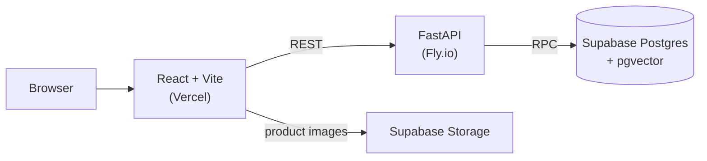

# H&M Recommender

**Live demo: [h-and-m-recommender-system.vercel.app](https://h-and-m-recommender-system.vercel.app)**

A live-updating fashion recommender built on the [H&M Personalized Fashion Recommendations](https://www.kaggle.com/competitions/h-and-m-personalized-fashion-recommendations) dataset (~105k products). Pick a starting point, then like, dislike, or add items to a (fake) cart — every interaction reshapes your feed in real time.

> The first load may take a few seconds while the backend wakes up.

## How it works

The engine is deliberately a single, explainable mechanism: every profile is one 384-dimensional **preference vector** that lives in the same embedding space as the products.

1. **Product embeddings** — each article's text metadata (name, type, colour, garment group, description, …) is embedded with `sentence-transformers` (`all-MiniLM-L6-v2`, 384-dim) and stored in Postgres with `pgvector`.
2. **Cold start** — a new profile is seeded from one of:
   - a **category average** (Ladieswear, Menswear, Divided, Baby/Children, Sport), or
   - the **global average** — the running mean of everything anyone has liked or carted ("what everyone's into").
3. **Recommendations** — nearest neighbours to the profile vector by cosine similarity (ivfflat index).
4. **Feedback loop** — each interaction nudges the profile vector:

   ```
   preference = (1 − β) · preference + β · item_embedding      β = 0.15 (like / cart)
   preference = (1 + β) · preference − β · item_embedding      dislike pushes away
   ```

   Likes and carts also update the global average with an online mean, so the default starting point drifts as people use the app. Carted and disliked items are excluded from future results.
5. **Search** — Postgres full-text search over product name + description, then re-ranked by similarity to your profile, so two users searching "jacket" see different results.

All vector updates run as atomic Postgres functions (no read-modify-write in Python), so concurrent interactions can't clobber each other.

## Architecture



| Layer | Tech |
|---|---|
| Frontend | React 18, TypeScript, Vite, Tailwind CSS, TanStack Query |
| Backend | FastAPI, supabase-py |
| Database | Supabase Postgres, pgvector (ivfflat cosine index), full-text search (GIN) |
| ML | sentence-transformers `all-MiniLM-L6-v2` |
| Hosting | Vercel (frontend), Fly.io (backend), Supabase (DB + images) |

## API

| Method | Endpoint | Description |
|---|---|---|
| `GET` | `/profiles/categories` | Cold-start categories with item counts |
| `GET` | `/profiles/presets` | Curated preset profiles |
| `POST` | `/profiles/fork?category=…` / `?preset_id=…` | Create a profile (no params = global average) |
| `GET` | `/profiles/{id}/recommendations?limit=20` | Personalized feed |
| `POST` | `/profiles/{id}/interactions` | `{ "article_id": 123, "type": "like" \| "dislike" \| "cart" }` |
| `GET` | `/profiles/{id}/search?q=…` | Keyword search ranked by profile similarity |
| `POST` | `/profiles/{id}/reset` | Re-seed from the original starting point |
| `DELETE` | `/profiles/{id}` | Delete a profile |
| `GET` | `/health` | Health check (includes DB connectivity) |

Interactive docs are served at `/docs` on the backend.

## Project structure

```
backend/
  main.py              FastAPI app, CORS, health check
  recommendations.py   Profile, interaction, recommendation and search endpoints
  config.py            Tunables (β, result limits)
  sql/                 pgvector RPCs: matching, nudges, profile forking, search
  smoke_test.py        End-to-end test of the recommendation loop
frontend/
  src/components/      Profile picker, product grid, product card
  src/api.ts           Typed API client
```

## Running locally

**Backend** (Python 3.12)

```bash
cd backend
python -m venv .venv && source .venv/bin/activate
pip install -r requirements.txt
# .env: SUPABASE_URL=...  SUPABASE_KEY=<service key>
uvicorn main:app --reload --port 8000
python smoke_test.py   # fork → recommend → like → cart → reset → delete
```

The database needs the `products`, `profiles`, `interactions` and `global_state` tables, then the migrations in `backend/sql/` run in order.

**Frontend**

```bash
cd frontend
npm install
echo "VITE_API_URL=http://localhost:8000" > .env.local
npm run dev
```
